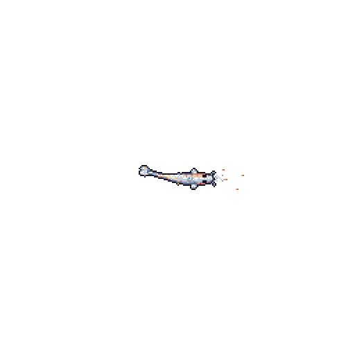

<h1 align="center">Hi, I'm Benja 👋</h1>
<h3 align="center">AI Engineer & Full Stack Developer · Córdoba, Argentina</h3>

  
  
  

p>

I build AI-powered software end to end: **React/TypeScript** front ends, **Python** back ends and automation, **Flutter** mobile apps and **CI/CD on AWS**. I'm focused on taking AI from demo to production, from **LLM agents and workflow automation with Claude Code** to **computer vision running on-device, no cloud**.

Final-year Systems Engineering student at Universidad Católica de Córdoba (last course left). English C1.

---

### 🛠️ What I've built

- **Full Stack Developer (BriskBox · Vinseg · Quality Car, 2025–2026):** full stack CRM for Quality Car, Android app for Vinseg, and CI/CD pipelines that sped up releases. Tech lead of **Brisk-Bot**, an internal Python service (Slack API + AWS) that validates, notifies and manages employee shift replacements.
- **AI automation:** agent skills, plugins and connectors that automate internal workflows with Claude Code and Codex.
- **Thesis: Edge AI driving assistant for a '94 Renault 9.** Flutter + native Kotlin app that detects people, cars, motorcycles and traffic lights in real time with TensorFlow Lite and a sub-USD 10 ESP32-CAM, 100% offline. It also learns my routes and compares alternatives at forks using stats from my own trips.

### 📌 Featured projects

| Project | What it is | Stack |
|---|---|---|
| [**ramas**](https://github.com/BenjAngelone/ramas) | Board for small teams and AI agents: from a voice note to a shipped feature | JavaScript |
| [**clawdmeter**](https://github.com/BenjAngelone/clawdmeter) | ESP32-S3 desk companion: a pixel-art robot that reacts to your Claude Code usage | C++ · LVGL 9 · Python |
| [**gear-dash**](https://github.com/BenjAngelone/gear-dash) | Smart gear-knob display for a Renault 9: IMU gear detection, safety-first touch UI | C · ESP32-S3 · LovyanGFX |
| [**oled-eyes**](https://github.com/BenjAngelone/oled-eyes) | Expressive animated eyes on a 128×64 OLED with a layered, data-driven animation engine | C++ · ESP32 |
| [**valheim-combat-bot**](https://github.com/BenjAngelone/valheim-combat-bot) | Real-time OpenCV + local vision model (Ollama) that reads the HUD and decides strategy | Python · OpenCV · Ollama |

### 🧰 Tech stack

- **Languages:** TypeScript · JavaScript · Python · Dart · Kotlin · Go · C/C++
- **Front end & mobile:** React · React Native · Flutter
- **AI:** LLM agents · Claude Code · Codex · OpenCV · TensorFlow Lite · Ollama
- **Cloud & DevOps:** AWS (EC2) · Docker · GitHub Actions · CI/CD · Firebase
- **Data:** PostgreSQL · MySQL · SQL Server · Pandas · Power BI
- **Embedded:** ESP32 · Arduino · LVGL · MQTT
- **Ways of working:** Scrum/Kanban · TDD · code review

  

---

  🔎 Looking for <b>AI Engineer, Full Stack or Mobile</b> roles, remote or in Córdoba. Available immediately. 
  🇦🇷 También en español: <a href="https://www.linkedin.com/in/benjangelone">escribime por LinkedIn</a>.

